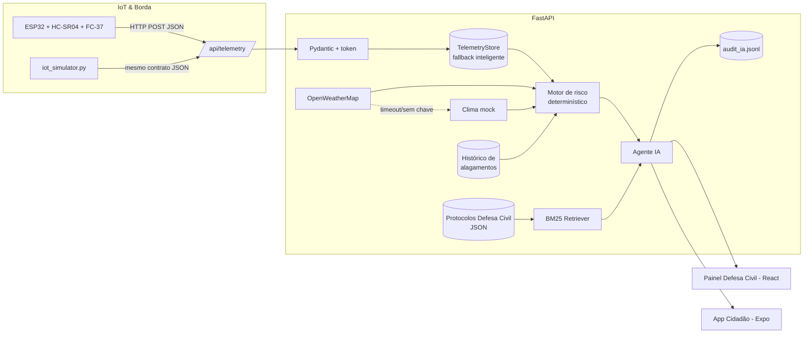

# Arquitetura — AquaGuard / AlertaCidadão

## Decisões de arquitetura
| Decisão | Motivo |
|---|---|
| Risco calculado por regras explicáveis, não pelo LLM | Decisão crítica de segurança não pode alucinar; auditável |
| RAG com BM25 local | Roda offline na banca, sem GPU/chave; troca futura por embeddings |
| LLM opcional (modo extrativo como padrão) | Demonstração nunca depende de serviço externo |
| Fallback em 3 camadas (real → simulado → sintético) | ESP32 ausente não quebra nada; dado sempre rotulado |
| Pseudonimização + grade de ~1 km + remoção de PII | LGPD: minimização de dados |

## Score de risco
score = 45% × nível do rio/cota de transbordamento + 20% × chuva no sensor + 25% × previsão 48h (saturação 100 mm) + 10% × histórico da área.
VERMELHO: rio ≥ 350 cm ou score ≥ 75 · AMARELO: rio ≥ 250 cm, score ≥ 40 ou previsão do dia ≥ 30 mm · senão VERDE.
